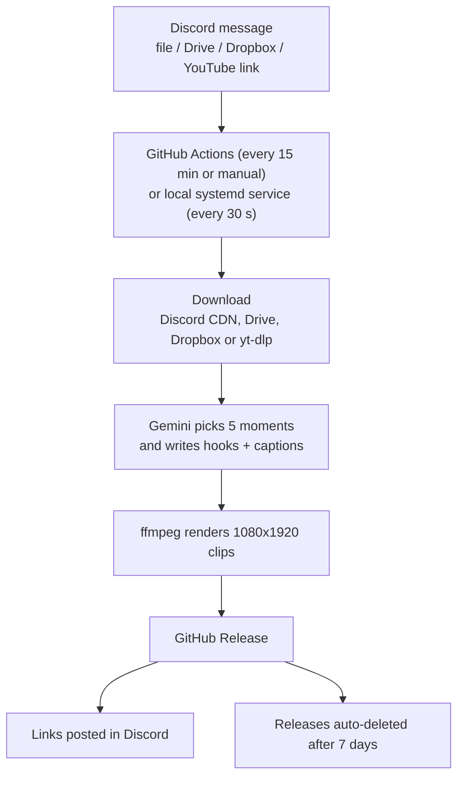

# clip-clip

Turn long videos into 5 ready-to-post vertical clips with AI hooks and captions, straight from Discord.

<!-- DEMO: add demo.gif here -->

## What it does

- Takes a video from a Discord message: a file upload, a Google Drive or Dropbox share link, or a YouTube link.
- Uses Gemini to listen to the whole video and pick the 5 strongest 30-60 second moments.
- Renders each moment as a 1080x1920 vertical clip with a hook line on top, plus a ready-to-paste caption with hashtags.
- Posts download links back in the same Discord channel and cleans the files up after 7 days.

## How it works



The cloud runner and the local service can both be active. The bot marks a message with a
reaction while it works on it, so the two never process the same video twice.

## Tech stack

- Python 3.12
- Gemini API (audio understanding, JSON output)
- ffmpeg
- yt-dlp (with Deno as the JavaScript runtime)
- Discord bot (REST API)
- GitHub Actions and GitHub Releases
- systemd user service

## Output

| | |
|---|---|
| Format | MP4, H.264 + AAC, 1080x1920, 30 fps |
| Clips per video | 5 (fewer for short videos) |
| Clip length | 30-60 seconds |
| On each clip | One hook line at the top |
| In Discord | Download link, timestamps and a caption with hashtags per clip |
| Processing time | Typically 10-30 minutes per video |

## Setup

### 1. Discord bot

Create an application at the Discord Developer Portal, add a bot, turn on **Message Content Intent**,
and invite it to your server with View Channels, Send Messages, Attach Files and Read Message History.
Put your channel ID in `DISCORD_CHANNEL_ID` in `.github/workflows/clip.yml`.

### 2. Cloud mode (GitHub Actions)

Add these repository secrets (Settings > Secrets and variables > Actions):

| Secret | Required | Purpose |
|---|---|---|
| `DISCORD_BOT_TOKEN` | Yes | Read the channel and post replies |
| `GEMINI_API_KEY` | Yes | Pick moments and write hooks and captions |
| `YT_COOKIES` | For YouTube links | cookies.txt from a separate Google account; YouTube blocks cloud runners without it |

The `clip` workflow runs every 15 minutes. To run it right away, open Actions > clip > Run workflow.
To only check that the YouTube cookies still work, enter a link in the `test_url` field.
The `keepalive` workflow runs monthly so GitHub does not pause the schedule.

### 3. Local mode (systemd)

```bash
python3 -m venv .venv
.venv/bin/pip install -r requirements.txt
```

Create `.env` next to `clip.py` (it is git-ignored):

```
DISCORD_BOT_TOKEN=...
DISCORD_CHANNEL_ID=...
GEMINI_API_KEY=...
```

Run it as a user service so it starts at login:

```ini
# ~/.config/systemd/user/clip-clip.service
[Service]
WorkingDirectory=/path/to/clip-clip
ExecStartPre=-/path/to/clip-clip/.venv/bin/pip install -q -U "yt-dlp[default]"
ExecStart=/path/to/clip-clip/.venv/bin/python -u clip.py --watch
Restart=always

[Install]
WantedBy=default.target
```

```bash
systemctl --user enable --now clip-clip
```

Local mode needs ffmpeg and `gh` (logged in) on the machine. YouTube usually works from a home
connection without cookies.

### Test without Discord

```bash
.venv/bin/python clip.py --local path/to/video.mp4
.venv/bin/python clip.py --local "https://www.youtube.com/watch?v=..."
```

Clips are written to `out/`.

## Limitations

- GitHub can delay free-tier scheduled runs by 1-4 hours. Use Run workflow, or the local service, for faster results.
- File inputs are limited to 500 MB. Discord's own upload limit is lower on free accounts, so use Drive or Dropbox for bigger files.
- Drive and Dropbox links must be shared as "Anyone with the link".
- YouTube may block downloads from cloud runners. The cookies need to be refreshed every few weeks.
- Clip download links are public URLs until the release is deleted.

## Note

This tool is intended for creators clipping their own content, or content they have the rights to use.
